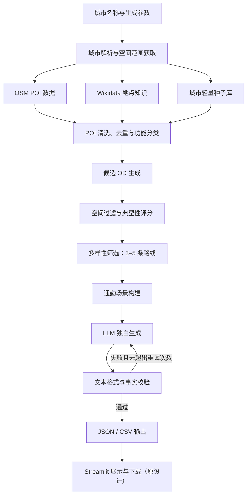

# 城市典型通勤路线发现与情景独白生成系统

> 文档说明：本文为用户提供的原始 v0.1 技术设计草案存档，不代表当前功能全部已实现。当前项目已采用命令行脚本和 JSON 输出；OSM/Wikidata 接入、Streamlit、CSV、语义事实校验及部分参数仍属于原设计或后续规划。安装、运行和已实现功能以 [README.md](README.md) 为准。本文仅清理粘贴产生的样式与引用卡片残留，并按原文流程重建示意图。

技术设计文档（MVP）

| 项目属性   | 内容                    |
| ------ | --------------------- |
| 项目名称   | CityCommuteNarrator   |
| 文档版本   | v0.1                  |
| 项目阶段   | MVP（最小可行产品）           |
| 开发语言   | Python 3.11+          |
| 核心技术   | OSM、Wikidata、规则引擎、LLM |
| 初始覆盖城市 | 北京、上海、广州、深圳           |
| 扩展目标   | 支持输入任意中国城市            |
| 数据来源原则 | 免费、开放、易获取、可追溯         |
| 部署方式   | 本地运行，支持后续服务化部署        |

## 1. 项目概述

### 1.1 项目背景

不同城市存在具有代表性的出行路线，例如北京的“回龙观 → 中关村”、上海的“莘庄 → 陆家嘴”、深圳的“龙华 → 南山科技园”等。这些路线反映了城市内部的职住空间关系、交通枢纽布局、产业集聚特征及居民出行习惯。

传统路线规划服务主要关注最短路径、最短时间或交通方式选择，而本项目重点关注路线的城市代表性、典型出行场景及其背后的社会生活语义。

系统通过开放地理数据自动发现城市中的典型起终点（OD），再结合通勤场景规则和大语言模型，生成符合路线空间特征与人群行为的第一人称内心独白。

### 1.2 项目目标

构建一个轻量级城市典型出行路线与情景文本生成系统。

用户只需要输入城市名称，系统即可：

1. 自动获取该城市的代表性居住区、就业中心、交通枢纽和城市地标。
2. 基于空间关系、功能匹配及城市知识，生成候选 OD。
3. 筛选出 3–5 条具有城市代表性的路线。
4. 为每条路线构造典型出行人群、目的、时间与潜在困难。
5. 调用 LLM 生成符合场景的第一人称内心独白。
6. 校验文本格式并输出结构化 JSON / CSV。

默认文本要求：

- 第一人称，自然、生活化。
- 每条路线生成 5–6 句话。
- 每句话约 20–30 个汉字。
- 内容体现人群、出行目的和潜在出行困难。
- 句数、字数及文本风格可配置。

### 1.3 MVP 范围

| 功能            | MVP | 后续版本      |
| ------------- | --- | --------- |
| 中文城市名称输入      | 支持  | 支持批量城市    |
| OSM POI 查询    | 支持  | 数据质量优化    |
| Wikidata 地点补充 | 支持  | 地点知名度优化   |
| 城市种子库         | 支持  | 自动扩充      |
| 候选 OD 生成      | 支持  | 结合真实出行数据  |
| 典型性评分与筛选      | 支持  | 数据驱动评分    |
| 场景构建          | 支持  | 更精细的人群画像  |
| LLM 独白生成      | 支持  | 多模型与多风格   |
| 句数、字数校验       | 支持  | 语义及事实校验增强 |
| Streamlit 界面  | 支持  | Web API   |
| 道路与公交精确路径     | 不支持 | 按需扩展      |
| 实时交通拥堵分析      | 不支持 | 按需扩展      |
| 实际 OD 客流识别    | 不支持 | 有数据时扩展    |

重要定义： MVP 中的“经典路线”是通过城市功能、地点知名度、空间合理性和种子知识共同推断出的代表性出行 OD，并不等价于通过真实客流数据识别的高频通勤路线。

此外，枢纽到景点等路线属于广义城市出行场景，不应与严格意义上的职住通勤混为一谈。

## 2. 系统总体架构

### 2.1 架构设计原则

系统采用轻量级模块化流水线架构，遵循以下原则：

- 数据与生成分离： 地理数据用于提供地点及空间事实，LLM 仅负责文本表达。
- 规则与模型分离： OD 生成及筛选使用可解释规则，避免完全依赖 LLM。
- 事实与假设分离： 明确标记已验证信息、规则推断信息及模拟情景。
- 模型可替换： 使用统一 LLM 接口，支持云端 API 或本地模型。
- 城市可扩展： 新增城市原则上只需补充少量城市配置及种子数据。
- 结果可追溯： 记录 POI 来源、路线评分及生成参数。
- 优先离线缓存： 降低公共查询服务负载及重复请求。

### 2.2 总体流程

<!-- 复制内容仅保留了流程节点文字；下图按文档流程重建。 -->



### 2.3 模块划分

| 模块                  | 核心职责           | 技术实现               |
| ------------------- | -------------- | ------------------ |
| City Resolver       | 城市名称解析、空间范围获取  | OSMnx、Wikidata     |
| POI Collector       | 城市地理实体采集       | OSMnx、Overpass API |
| Knowledge Enricher  | 地点补充、名称与知名度特征  | Wikidata SPARQL    |
| Seed Manager        | 维护典型居住区与就业区    | JSON               |
| POI Processor       | 标准化、去重、功能分类    | pandas、GeoPandas   |
| OD Generator        | 规则模板生成候选路线     | Python             |
| Route Ranker        | 候选 OD 评分与多样性筛选 | Python、GeoPandas   |
| Scenario Builder    | 人群、目的、出行困难构造   | 规则模板               |
| Narrative Generator | LLM 内心独白生成     | 模型 SDK             |
| Narrative Validator | 格式、长度及基础事实校验   | Pydantic、Python    |
| Application UI      | 参数输入与结果展示      | Streamlit          |
| Exporter            | 结构化结果输出        | JSON、CSV           |

## 3. 数据来源与数据集设计

### 3.1 数据来源概览

本项目优先采用无需付费、可公开访问、支持程序化获取的开放数据。

| 数据源           | 数据内容                 | 获取方式                 | 应用场景       |
| ------------- | -------------------- | -------------------- | ---------- |
| OpenStreetMap | POI、道路、车站、土地利用、部分建筑物 | OSMnx / Overpass API | 地点发现、空间分析  |
| Wikidata      | 地标知识、地点类型、多语言名称、坐标   | SPARQL API           | 地点补充、知名度评估 |
| 城市种子库         | 典型居住区、产业园、商务区及已知 OD  | 本地 JSON              | 提高路线典型性    |
| 开源地铁数据（可选）    | 地铁线路、站点及空间位置         | GitHub / 本地文件        | 交通场景补充     |

数据源地址：

- OSM：https://www.openstreetmap.org/
- Overpass Turbo：https://overpass-turbo.eu/
- Wikidata：https://www.wikidata.org/
- Wikidata SPARQL：https://query.wikidata.org/
- OSMnx：https://osmnx.readthedocs.io/

OSMnx 的 `features_from_place` 支持按地名与标签提取地理要素，但要求能够解析相应的空间范围。Wikidata 可通过 SPARQL 接口返回 JSON 格式查询结果。


### 3.2 OSM 数据获取

OSM 主要负责获取地理实体及其空间位置。

初始关注以下地点类别：

| 地点类别 | OSM 标签                             | 说明          |
| ---- | ---------------------------------- | ----------- |
| 地铁站  | `railway=station`、`station=subway` | 轨道交通枢纽      |
| 火车站  | `railway=station`                  | 高铁及铁路车站     |
| 公交站  | `highway=bus_stop`                 | 公交交通节点      |
| 景点   | `tourism=attraction`               | 城市地标和景区     |
| 商业区  | `landuse=commercial`               | 商业办公功能区     |
| 居住区  | `landuse=residential`              | 居住用地        |
| 办公楼  | `building=office`                  | 就业活动的潜在空间载体 |

需要注意，OSM 标签获取的是地理要素，并非直接对应城市居民认知中的功能片区。

例如 `landuse=residential` 表示居住用地，并不说明该地点属于知名的通勤居住区。因此需进一步进行地点名称识别、聚合及种子匹配。

### 3.3 Wikidata 数据获取

Wikidata 用于补充地点的语义信息，主要包括：

- 地点名称、别名和多语言标签。
- 地点所属行政区域。
- 地点类型，例如地标、车站或商业中心。
- 经纬度坐标。
- 维基百科页面及跨语言链接信息。

可以将地点所关联的维基百科语言版本数量作为知名度的辅助指标，但不能将其直接等同于本地居民的知名度。

### 3.4 轻量城市种子库

由于 OSM 和 Wikidata 难以直接表达城市中的经典职住关系，本项目引入少量人工整理的城市种子信息。

种子库主要记录：

1. 典型居住片区。
2. 主要就业中心。
3. 交通枢纽。
4. 城市知名地标。
5. 少量经过人工确认的代表性 OD。

示例：

```
{
  "city": "北京",
  "residential_areas": [
    "回龙观",
    "天通苑",
    "通州北苑"
  ],
  "employment_centers": [
    "中关村",
    "国贸",
    "望京"
  ],
  "transport_hubs": [
    "北京南站",
    "北京西站"
  ],
  "landmarks": [
    "天安门",
    "故宫"
  ],
  "seed_routes": [
    {
      "origin": "回龙观",
      "destination": "中关村",
      "route_type": "residential_to_employment"
    }
  ]
}
```

种子地点的空间坐标应通过 OSM 或 Wikidata 查询获取，并记录匹配来源与置信度。对于地名歧义或范围较大的区域，可人工确认代表性中心点。

种子库作为辅助知识库，而非唯一的 OD 数据来源。没有配置种子库的城市仍可通过开放数据与通用规则生成候选路线，但需要降低结果置信度。

### 3.5 数据标准化

不同数据源需要转换成统一格式：

```
POI = {    "poi_id": str,    "name": str,    "city": str,    "category": str,    "longitude": float,    "latitude": float,    "source": str,    "source_id": str,    "popularity_score": float,    "confidence": float}
```

统一使用 WGS84（EPSG:4326）保存坐标。

对于 Polygon 类型地理实体，可以计算内部代表点作为 OD 锚点。

数据清洗主要包括名称标准化、坐标有效性检查、同名实体消歧、空间邻近去重和地点类别统一。

## 4. 典型路线发现模块

### 4.1 路线类型定义

MVP 支持三种主要路线类型。

| 类型代码                        | 中文名称  | 起点类型 | 终点类型    |
| --------------------------- | ----- | ---- | ------- |
| `residential_to_employment` | 职住通勤  | 居住区  | 就业中心    |
| `transport_to_landmark`     | 枢纽出行  | 交通枢纽 | 城市地标    |
| `business_to_employment`    | 商务区联系 | 商业中心 | 产业或就业中心 |

每座城市默认输出 4 条路线，尽可能覆盖多种场景。

建议配额为职住通勤 2 条、枢纽出行 1 条、商务区联系 1 条。若可用候选不足，则按照评分与多样性约束动态调整。

### 4.2 候选 OD 生成

根据路线类型模板，对对应类别的 POI 进行组合。

例如：

```
ROUTE_TEMPLATES = [    ("residential", "employment"),    ("transport", "landmark"),    ("business", "employment")]
```

对每一组候选 OD，计算：

- 起终点直线距离。
- 地点类型匹配情况。
- 地点知名度。
- 起终点数据可信度。
- 与其他候选路线的空间和语义重复程度。

对距离明显不合理、地点重复或功能不匹配的组合进行初步过滤。

### 4.3 路线典型性评分

MVP 使用启发式加权评分：

$$ S_{ij}=w_pP_{ij}+w_fF_{ij}+w_dD_{ij}+w_cC_{ij} $$

其中：

| 指标            | 含义          | 初始权重 |
| ------------- | ----------- | ---- |
| $P_{ij}$ | 起终点知名度      | 0.35 |
| $F_{ij}$ | 起终点功能匹配度    | 0.30 |
| $D_{ij}$ | 空间距离合理性     | 0.20 |
| $C_{ij}$ | 交通连接便利性代理指标 | 0.15 |

各指标统一归一化到 0–1。

上述权重属于初始经验参数，而不是通过真实通勤客流训练得到的统计权重。

其中 $C_{ij}$ 在 MVP 中可使用邻近轨道交通站点、道路网络可达性等粗略指标计算，不代表真实公交旅行时间。

### 4.4 多样性筛选

单纯选取评分最高的 5 条路线，容易出现终点集中在同一个 CBD 或路线类型单一的问题。

因此采用贪心式多样性筛选：

1. 按路线典型性评分降序排列。
2. 优先满足各场景类型配额。
3. 限制同一起点或终点的重复次数。
4. 排除空间距离和语义高度相似的 OD。
5. 选取最终 3–5 条路线。

这一流程既保证路线具有一定代表性，也确保结果能够覆盖不同城市生活场景。

## 5. 通勤场景构建模块

### 5.1 模块目标

场景构建模块是连接地理信息和 LLM 文本生成的中间层。

它不直接生成自然语言独白，而是根据 OD 的空间及功能属性，生成结构化的出行情景。

主要包括：

- 典型人群身份。
- 出行目的。
- 可能的出行时间。
- 可能使用的交通方式。
- 潜在出行困难。
- 与城市空间特征相关的生活细节。

### 5.2 场景规则

| 路线类型  | 典型人群      | 出行目的       | 潜在困难           |
| ----- | --------- | ---------- | -------------- |
| 职住通勤  | 上班族、产业园员工 | 工作日上下班     | 早高峰、拥挤、步行、换乘   |
| 枢纽出行  | 游客、出差人员   | 旅游、到访、办事   | 行李、出口辨识、路线不熟   |
| 商务区联系 | 商务人员、公司职员 | 工作、会议、商务活动 | 堵车、时间紧张、交通方式选择 |

这些是用于模拟的典型情景假设，不能视为该 OD 真实出行人口的统计结果。

### 5.3 事实与假设管理

为减少 LLM 幻觉，对场景中的信息标记证据等级。

| 证据等级                  | 定义                 |
| --------------------- | ------------------ |
| `verified`            | 已由地理数据、路径数据或其他来源核实 |
| `inferred`            | 根据空间位置、功能规则等进行推断   |
| `scenario_assumption` | 为模拟出行体验设定的合理情景     |

例如：

```
{
  "city": "北京",
  "origin": "回龙观",
  "destination": "中关村",
  "route_type": "residential_to_employment",
  "persona": {
    "occupation": "互联网从业者",
    "purpose": "早间上班",
    "time_period": "weekday_morning_peak"
  },
  "transport_mode": "metro",
  "challenges": [
    {
      "type": "crowding",
      "description": "早高峰可能拥挤",
      "evidence": "scenario_assumption"
    },
    {
      "type": "walking",
      "description": "出站后可能需要步行",
      "evidence": "scenario_assumption"
    }
  ]
}
```

未经核实的地铁线路编号、站点换乘关系、出口编号、精确出行时长等信息，不应由 LLM 自行补全。

## 6. LLM 情景独白生成模块

### 6.1 生成目标

LLM 需要将结构化出行情景转换为自然、真实、具有城市生活特征的第一人称内心独白。

默认生成参数：

```
narrative:
  num_sentences: 6
  min_chars: 20
  max_chars: 30
  tone: natural
  perspective: first_person
  include_challenges: true
  temperature: 0.7
  max_retries: 2
```

其中句数、字数、风格以及采样温度均通过配置文件管理。

### 6.2 Prompt 设计

采用固定 System Prompt 和动态场景输入。

System Prompt：

```
你是一名擅长描写中国城市日常生活的中文作者。

请根据输入的城市、路线、人物和出行情景，
生成一段自然、真实的第一人称内心独白。

要求：

1. 使用第一人称，避免旁观者式叙述。
2. 体现人物的出行目的和生活背景。
3. 结合路线特点，适当描述潜在交通困难。
4. 语言口语化，避免文学化、说教或总结式表达。
5. 不要将所有路线都写成单纯抱怨上班。
6. 不得编造未验证的地铁线路、换乘站、
   出口编号、精确耗时和交通拥堵事实。
7. 对场景假设使用自然但不过度确定的表达。
8. 严格满足指定句数及每句字数要求。
9. 返回 JSON，包含 sentences 字符串数组。
```

动态输入包含：

```
{
  "scenario": {
    "city": "北京",
    "origin": "回龙观",
    "destination": "中关村",
    "persona": "互联网从业者",
    "purpose": "工作日早间上班",
    "challenges": [
      "早高峰可能拥挤",
      "出站后需要步行"
    ]
  },
  "generation_config": {
    "num_sentences": 6,
    "min_chars": 20,
    "max_chars": 30,
    "tone": "natural"
  }
}
```

### 6.3 LLM 接入

推荐使用统一模型调用接口，降低对特定模型服务商的依赖。

| 方案                | 优点                | 不足               |
| ----------------- | ----------------- | ---------------- |
| 云端 LLM API        | 集成简单、维护成本低        | 可能存在调用费用         |
| 本地开源权重模型          | 无逐次 API 费用、便于离线运行 | 需要本地计算资源         |
| 兼容 OpenAI API 的服务 | 模型切换方便            | 不同服务的结构化输出能力存在差异 |

MVP 优先实现云端 API 接入，同时保留本地模型兼容能力。

建议封装统一接口：

```
def generate_narrative(    scenario: dict,    config: dict,    model: str) -> list[str]:    ...
```

实际调用 SDK 时，通过适配层处理不同模型的结构化输出接口、认证方式及异常重试。

### 6.4 文本校验

LLM 输出后进行自动校验，包括：

格式校验

- 返回内容必须是合法 JSON。
- `sentences` 字段必须是字符串数组。
- 句子数量必须满足配置。

字数校验

- 按统一字符计数规则统计每句话。
- 默认排除句末标点。
- 超出范围时要求模型重写相应句子。

基础内容校验

- 是否符合第一人称叙述。
- 是否包含未授权的具体路线事实。
- 是否与当前人物、出行目的和场景相符。
- 是否出现明显重复或前后矛盾。

对于未通过校验的结果，最多重新生成 2 次。

需要注意，简单规则能够验证格式、句数及部分事实约束，但不能完全保证文字的真实性和自然程度。MVP 仍需通过人工抽样评估生成质量。

## 7. 技术栈

### 7.1 核心依赖

| 类别      | 技术                | 用途              | 必要性 |
| ------- | ----------------- | --------------- | --- |
| 开发语言    | Python 3.11+      | 系统开发            | 必需  |
| 地理数据    | OpenStreetMap     | POI 与空间数据       | 必需  |
| 地理知识    | Wikidata          | 地点语义补充          | 必需  |
| OSM 获取  | OSMnx             | OSM 查询与处理       | 必需  |
| 空间计算    | GeoPandas、Shapely | 几何计算与空间处理       | 必需  |
| 数据处理    | pandas            | POI 清洗与数据组织     | 必需  |
| HTTP 请求 | requests / httpx  | Wikidata API 请求 | 必需  |
| 配置管理    | PyYAML            | 参数配置            | 推荐  |
| 模型调用    | OpenAI SDK 或兼容客户端 | LLM 接口          | 必需  |
| 数据校验    | Pydantic          | JSON 结构验证       | 必需  |
| 用户界面    | Streamlit         | Web 输入及展示       | 推荐  |
| 数据存储    | JSON / CSV        | 种子库与结果缓存        | 必需  |
| 环境管理    | venv + pip        | 依赖管理            | 推荐  |
| 单元测试    | pytest            | 模块测试            | 推荐  |

MVP 暂不引入 PostgreSQL、PostGIS、Redis、Celery、向量数据库或 Agent 框架。

后续只有在数据规模、并发量或检索需求明确增加时，再考虑引入这些组件。

### 7.2 安装依赖

```
pip install \
    osmnx \
    geopandas \
    shapely \
    pandas \
    requests \
    pyyaml \
    pydantic \
    openai \
    streamlit \
    pytest
```

具体版本建议在首次完成环境验证后锁定到 `requirements.txt`。

Streamlit 支持通过 `pip` 安装并在本地启动应用。


## 8. 项目目录结构

建议按照模块职责进行组织：

```
CityCommuteNarrator/
│
├── app.py
├── main.py
├── requirements.txt
├── README.md
│
├── config/
│   ├── settings.yaml
│   ├── city_aliases.json
│   ├── route_templates.yaml
│   └── narrative_config.yaml
│
├── data/
│   ├── seeds/
│   │   ├── beijing.json
│   │   ├── shanghai.json
│   │   ├── guangzhou.json
│   │   └── shenzhen.json
│   │
│   ├── cache/
│   │   ├── osm/
│   │   └── wikidata/
│   │
│   └── output/
│
├── src/
│   ├── city_resolver.py
│   ├── poi_collector.py
│   ├── wikidata_client.py
│   ├── seed_manager.py
│   ├── poi_processor.py
│   ├── od_generator.py
│   ├── route_ranker.py
│   ├── scenario_builder.py
│   ├── narrative_generator.py
│   ├── narrative_validator.py
│   └── exporter.py
│
└── tests/
    ├── test_od_generator.py
    ├── test_route_ranker.py
    ├── test_scenario_builder.py
    └── test_narrative_validator.py
```

其中：

- `main.py` 负责完整流水线调度。
- `app.py` 负责 Streamlit 页面。
- `config/` 管理业务规则和模型参数。
- `data/seeds/` 存放城市轻量种子库。
- `data/cache/` 缓存开放数据查询结果。
- `src/` 包含主要功能模块。
- `tests/` 提供自动化测试。

## 9. 系统输入与输出接口

### 9.1 输入接口

```
def generate_city_commutes(    city: str,    num_routes: int = 4,    num_sentences: int = 6,    min_chars: int = 20,    max_chars: int = 30,    tone: str = "natural",    model: str | None = None) -> dict:    ...
```

输入参数说明：

| 参数              | 类型          | 默认值     | 含义         |
| --------------- | ----------- | ------- | ---------- |
| `city`          | string      | 必填      | 中文城市名称     |
| `num_routes`    | integer     | 4       | 路线数量，3–5   |
| `num_sentences` | integer     | 6       | 每条独白句数     |
| `min_chars`     | integer     | 20      | 每句最少字符数    |
| `max_chars`     | integer     | 30      | 每句最多字符数    |
| `tone`          | string      | natural | 独白语言风格     |
| `model`         | string/null | null    | 使用的 LLM 模型 |

### 9.2 输出接口

系统统一输出 JSON 对象：

```
{
  "city": "北京",
  "route_count": 1,
  "generation_config": {
    "num_sentences": 6,
    "min_chars": 20,
    "max_chars": 30,
    "tone": "natural"
  },
  "routes": [
    {
      "route_id": "beijing_001",
      "origin": {
        "name": "回龙观",
        "longitude": null,
        "latitude": null,
        "type": "residential"
      },
      "destination": {
        "name": "中关村",
        "longitude": null,
        "latitude": null,
        "type": "employment"
      },
      "route_type": "residential_to_employment",
      "typicality_score": null,
      "scenario": {
        "persona": "互联网从业者",
        "purpose": "工作日早间上班",
        "transport_mode": "metro",
        "challenges": [
          "早高峰可能拥挤",
          "出站后可能需要步行"
        ]
      },
      "narrative": {
        "sentences": [],
        "text": ""
      },
      "sources": [
        "OSM",
        "Wikidata",
        "Seed"
      ]
    }
  ]
}
```

上述 JSON 仅用于定义结构，`null` 和空数组表示尚未执行实际数据查询及文本生成。

正式输出时应填充经过验证的坐标、评分与独白内容，同时包含查询时间、数据来源标识及生成状态。

## 10. MVP 开发计划

建议按以下顺序实施。

阶段一：开放数据获取

完成城市名称解析、OSM/Wikidata 查询、POI 标准化和本地缓存。先验证北京、上海、广州、深圳四个城市的数据覆盖情况。

阶段二：路线发现

构建种子库、OD 模板、空间过滤及路线评分模块，确保每座试点城市能够得到 3–5 条基本合理的候选路线。

阶段三：场景及文本生成

实现 Scenario Builder、LLM 接口、Prompt 模板和文本校验，确保人物、目的、困难与路线类型一致。

阶段四：界面与集成测试

开发 Streamlit 页面，支持城市选择、生成参数设置、路线与独白展示，以及 JSON/CSV 导出。

### 10.1 MVP 验收标准

| 验收维度  | 建议标准                   |
| ----- | ---------------------- |
| 城市覆盖  | 完成北京、上海、广州、深圳四城测试      |
| 路线数量  | 每城目标 3–5 条，数量不足时明确提示   |
| 地点有效性 | 已输出的 OD 均能追溯来源及空间坐标    |
| 路线典型性 | 人工评估认为基本合理的比例 ≥80%     |
| 场景匹配度 | 人物、目的与 OD 类型一致的比例 ≥90% |
| 格式正确性 | JSON 结构验证通过率 100%      |
| 文本长度  | 最终输出满足配置句数、字符数         |
| 事实一致性 | 不出现已发现的无依据具体交通事实       |
| 城市扩展  | 非种子城市可尝试自动生成并报告置信度     |

这里的人工评估指标属于项目验收目标，需实际测试后才能得到结果。

### 10.2 主要风险及处理方式

| 风险             | 影响        | 应对措施                 |
| -------------- | --------- | -------------------- |
| 中国城市 OSM 数据稀疏  | 候选地点数量不足  | Wikidata 补充、种子库兜底    |
| 地名歧义           | 获取错误位置    | 城市范围校验、别名匹配          |
| 候选 OD 缺乏真实代表性  | 路线不符合本地认知 | 典型性评分、种子库、人工抽查       |
| LLM 编造交通信息     | 独白真实性下降   | 结构化证据、Prompt 约束、规则校验 |
| 公共 API 限流或查询失败 | 数据获取不稳定   | 本地缓存、请求重试、速率控制       |
| LLM 调用费用       | 长期成本增加    | 批量处理、结果缓存、本地模型       |
| 不同城市差异较大       | 通用规则效果不一致 | 通用模板与城市配置结合          |

开放数据使用时应遵守数据源许可证及公共接口使用规则。尤其是 OSM 数据的 ODbL 署名和共享条件，需要结合最终数据分发方式进行确认。

## 11. 后续扩展方向

MVP 完成后，可以按需求扩展：

更可靠的交通情景。 引入合法可用的公交 GTFS、道路网络或开源路径规划引擎，获得实际换乘信息、步行距离及路线几何，减少场景描述中的假设成分。

更精细的城市代表性评估。 引入公开的城市规划材料、人口及就业空间统计、开放出行调查，改进知名度和 OD 典型性评分。

更丰富的文本生成。 支持早晚高峰、工作日与周末、职业、情绪、语言风格等多维条件控制，为同一条 OD 生成不同人物视角的独白。

更系统的自动化评估。 构建人工标注测试集，评估路线合理性、场景一致性、城市特征表达、叙事自然度与事实可靠性。

## 12. 总结

本项目采用开放地理数据、轻量规则引擎与 LLM 协同的技术架构，通过六个核心步骤构建城市典型出行场景：

城市解析 → 地点发现 → OD 生成 → 典型性筛选 → 场景构建 → 内心独白生成。

MVP 不依赖真实移动轨迹数据、付费地图 API、复杂数据库或多智能体框架，优先保证实现速度和模块可维护性。

其中，路线典型性筛选和结构化场景构建 是系统质量的关键。前者决定路线是否符合城市空间生活经验，后者决定 LLM 能否生成具有地域特色、出行动机和真实生活感的文本。

第一版以四座一线城市为验证对象，逐步形成一套可推广到其他中国城市的标准化路线与情景文本生成流程。

文档版本：v0.1 · MVP 技术设计草案 · 2026-10-10
